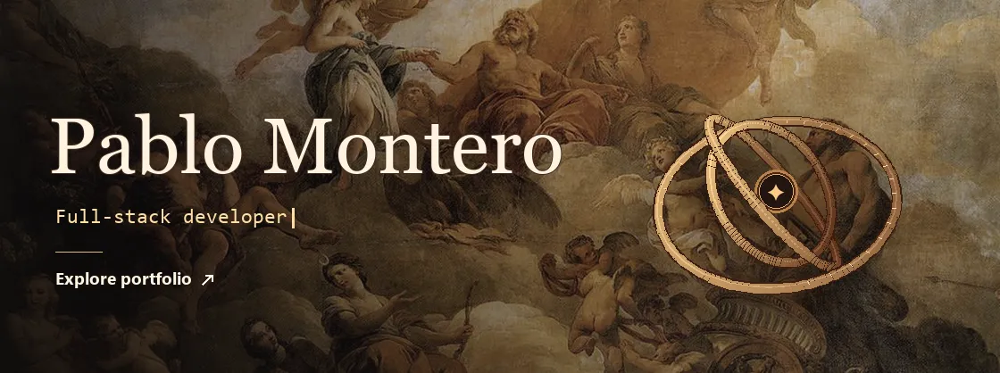
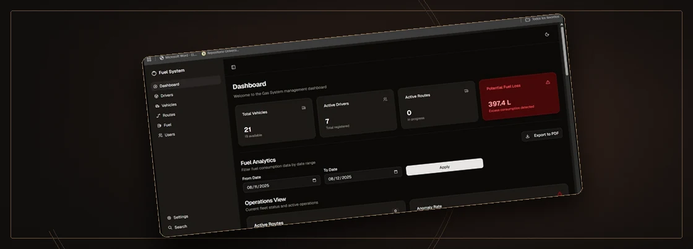
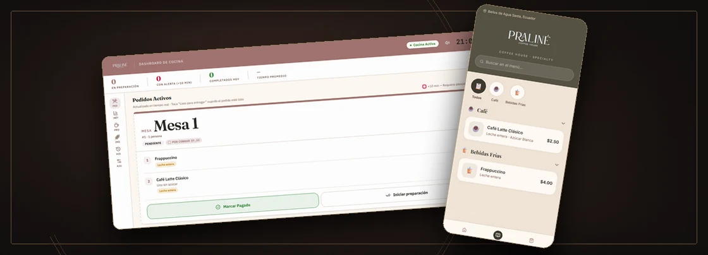
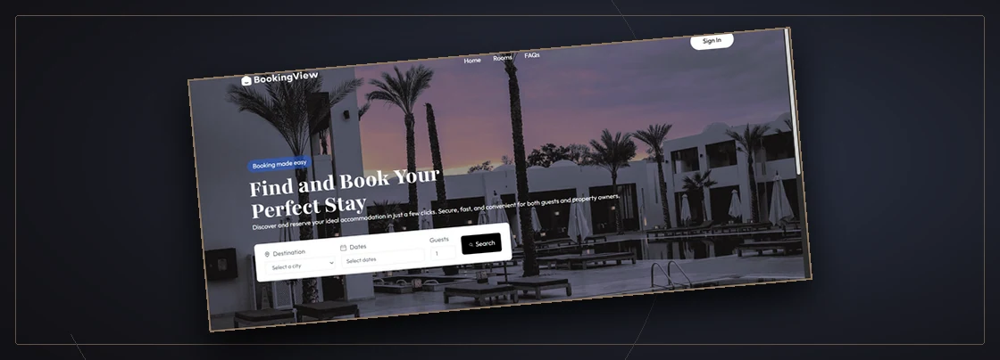
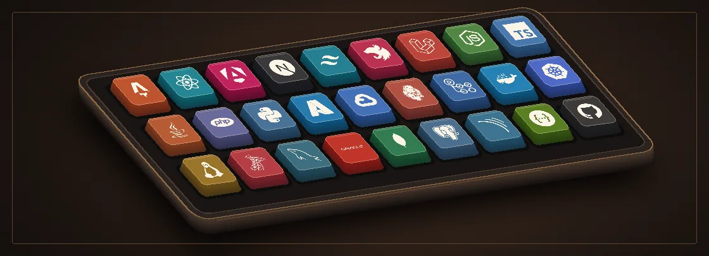
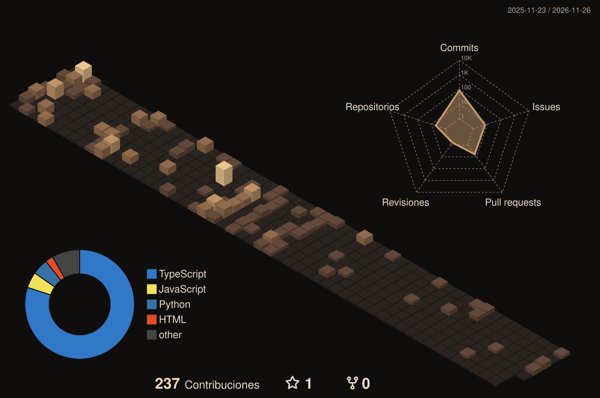

[Español](README.md) · **English**

<a href="https://pabloaml-portfolio.vercel.app/">
  <picture>
    <source media="(prefers-reduced-motion: reduce)" srcset="assets/portada-olimpo-en.jpg">
    
  </picture>
</a>

# Pablo Montero

[Portfolio](https://pabloaml-portfolio.vercel.app/) · [LinkedIn](https://www.linkedin.com/in/pablo-montero-lopez/) · [Email](mailto:monteropablo511@gmail.com)

## About me

I’m a **full-stack developer** from Ambato, Ecuador. I’m interested in system architecture and in designing interfaces that make products easier to use. I’ve worked on web and mobile apps, APIs, and distributed systems. I also design landing pages for local businesses.

## Featured projects

<table>
  <tr>
    <td width="50%" valign="top">
      
      <h3>FuelOps</h3>
      
A distributed system for managing fleets, routes, and fuel use with microservices, gRPC, and NATS.

      
<strong>NestJS · TypeScript · PostgreSQL · MongoDB</strong>

      
<a href="https://fuelops.dayle.dev/demo">Read-only demo</a> · <a href="https://github.com/Application-Distributed-Gasoline-System/Backend">Backend</a>

    </td>
    <td width="50%" valign="top">
      
      <h3>Kaphiy</h3>
      
QR ordering for Praliné Coffee House with a mobile menu and a real-time kitchen dashboard.

      
<strong>Next.js · NestJS · PostgreSQL · Socket.IO</strong>

      
<a href="https://github.com/Arkasys-GDP/Kaphiy">Repository</a>

    </td>
  </tr>
  <tr>
    <td width="50%" valign="top">
      
      <h3>BookingView</h3>
      
A web and mobile platform for finding accommodation and managing bookings.

      
<strong>React · React Native · Node.js · MongoDB</strong>

      
<a href="https://bookingview.vercel.app/">Web demo</a> · <a href="https://github.com/DaGeus15/BookingView">Web code</a> · <a href="https://github.com/PabloAML1/booking-native">Mobile code</a>

    </td>
    <td width="50%" valign="top">
      
      <h3>HambaEC</h3>
      
A dental clinic landing page from my web development venture for local businesses in Ambato.

      
<strong>Astro · Tailwind CSS · GSAP</strong>

      
<a href="https://hamba-ec.vercel.app/">View landing page</a>

    </td>
  </tr>
</table>

## Technologies and tools

<a href="https://pabloaml-portfolio.vercel.app/#skills">
  <picture>
    <source media="(prefers-reduced-motion: reduce)" srcset="assets/teclado-herramientas.jpg">
    
  </picture>
</a>

[Explore the interactive keyboard](https://pabloaml-portfolio.vercel.app/#skills)

  
View all 27 tools

- **Frontend** · Astro, React, Angular, Next.js and Tailwind CSS.
- **Backend and languages** · NestJS, Laravel, Node.js, TypeScript, Java, PHP and Python.
- **DevOps and cloud** · Azure, Google Cloud, Jenkins, GitHub Actions, Docker, Kubernetes and Linux.
- **Databases** · SQL Server, MySQL, Oracle, MongoDB and PostgreSQL.
- **Tools and quality** · SonarQube, Swagger and GitHub.

## GitHub contributions

Cover adapted from [*The Apotheosis of Hercules* by François Lemoyne](https://commons.wikimedia.org/wiki/File:The_Apotheosis_of_Hercules.jpg). Keyboard logos from [Devicon](https://github.com/devicons/devicon), under the [MIT license](assets/devicon-license.txt). Map generated with [GitHub Profile 3D Contrib](https://github.com/yoshi389111/github-profile-3d-contrib).
