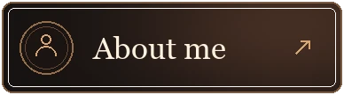
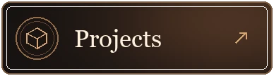
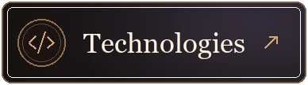
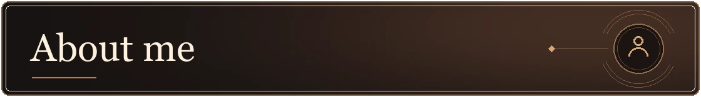
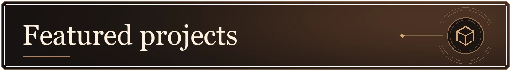
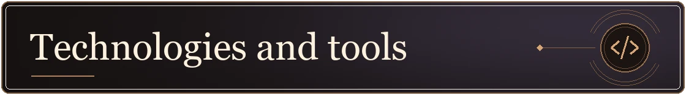
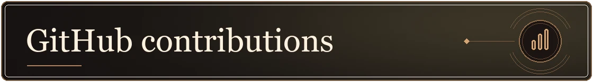
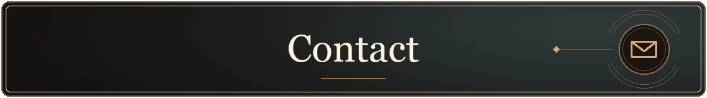

<a href="README.md">Español</a> · <strong>English</strong>

<a href="https://pabloaml-portfolio.vercel.app/">
  <picture>
    <source media="(prefers-reduced-motion: reduce)" srcset="assets/portada-olimpo-en.jpg">
    
  </picture>
</a>

  
  

  
  
  
  

<h2></h2>

Full-stack developer from Ambato, Ecuador. I build web and mobile applications, APIs, and distributed systems. I also design landing pages for local businesses.

<h2></h2>

<table>
  <tr>
    <td width="50%" valign="top">
       
      Fleet, route, and fuel management. 
      NestJS · PostgreSQL · MongoDB 
      <a href="https://fuelops.dayle.dev/demo">Demo</a> · <a href="https://github.com/Application-Distributed-Gasoline-System/Backend">Backend</a>
    </td>
    <td width="50%" valign="top">
       
      QR ordering and a kitchen dashboard. 
      Next.js · NestJS · Socket.IO 
      <a href="https://github.com/Arkasys-GDP/Kaphiy">Repository</a>
    </td>
  </tr>
  <tr>
    <td width="50%" valign="top">
       
      Accommodation booking on web and mobile. 
      React · React Native · Node.js 
      <a href="https://bookingview.vercel.app/">Demo</a> · <a href="https://github.com/DaGeus15/BookingView">Web</a> · <a href="https://github.com/PabloAML1/booking-native">Mobile</a>
    </td>
    <td width="50%" valign="top">
       
      Landing page for a dental clinic. 
      Astro · Tailwind CSS · GSAP 
      <a href="https://hamba-ec.vercel.app/">Website</a>
    </td>
  </tr>
</table>

<h2></h2>

<a href="https://pabloaml-portfolio.vercel.app/#skills">
  <picture>
    <source media="(prefers-reduced-motion: reduce)" srcset="assets/teclado-demo-en.jpg">
    
  </picture>
</a>

<a href="https://pabloaml-portfolio.vercel.app/#skills">Open the interactive keyboard ↗</a>

  
View all 27 tools

- **Frontend** · Astro, React, Angular, Next.js, Tailwind CSS.
- **Backend and languages** · NestJS, Laravel, Node.js, TypeScript, Java, PHP, Python.
- **DevOps and cloud** · Azure, Google Cloud, Jenkins, GitHub Actions, Docker, Kubernetes, Linux.
- **Databases** · SQL Server, MySQL, Oracle, MongoDB, PostgreSQL.
- **Tools and quality** · SonarQube, Swagger, GitHub.

<h2></h2>

<h2></h2>

  
  
  

<a href="mailto:monteropablo511@gmail.com">monteropablo511@gmail.com</a>

Cover adapted from [*The Apotheosis of Hercules* by François Lemoyne](https://commons.wikimedia.org/wiki/File:The_Apotheosis_of_Hercules.jpg). Logos from [Devicon](https://github.com/devicons/devicon) under the [MIT license](assets/devicon-license.txt). Map by [GitHub Profile 3D Contrib](https://github.com/yoshi389111/github-profile-3d-contrib).
