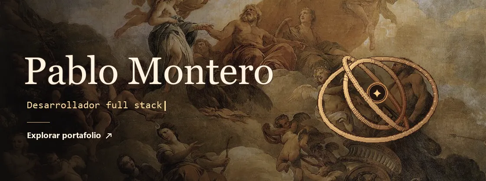
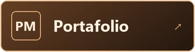

**Español** · [English](README.en.md)

<a href="https://pabloaml-portfolio.vercel.app/">
  <picture>
    <source media="(prefers-reduced-motion: reduce)" srcset="assets/portada-olimpo-es.jpg">
    
  </picture>
</a>

# Pablo Montero

## Sobre mí

Soy **desarrollador full stack** de Ambato, Ecuador. Me interesa la arquitectura de sistemas y cómo una buena interfaz vuelve más fácil usar un producto. He trabajado en aplicaciones web y móviles, APIs y sistemas distribuidos, y diseño landing pages para negocios locales.

## Proyectos destacados

<table>
  <tr>
    <td width="50%" valign="top">
      
      <h3>FuelOps</h3>
      
Gestión de flotas, rutas y consumo de combustible con microservicios, gRPC y NATS.

      
<strong>NestJS · TypeScript · PostgreSQL · MongoDB</strong>

      
<a href="https://fuelops.dayle.dev/demo">Demo de solo lectura</a> · <a href="https://github.com/Application-Distributed-Gasoline-System/Backend">Backend</a>

    </td>
    <td width="50%" valign="top">
      
      <h3>Kaphiy</h3>
      
Pedidos por QR para Praliné Coffee House, con menú móvil y panel de cocina en tiempo real.

      
<strong>Next.js · NestJS · PostgreSQL · Socket.IO</strong>

      
<a href="https://github.com/Arkasys-GDP/Kaphiy">Repositorio</a>

    </td>
  </tr>
  <tr>
    <td width="50%" valign="top">
      
      <h3>BookingView</h3>
      
Plataforma web y móvil para buscar alojamientos y gestionar reservas.

      
<strong>React · React Native · Node.js · MongoDB</strong>

      
<a href="https://bookingview.vercel.app/">Demo web</a> · <a href="https://github.com/DaGeus15/BookingView">Código web</a> · <a href="https://github.com/PabloAML1/booking-native">Código móvil</a>

    </td>
    <td width="50%" valign="top">
      
      <h3>HambaEC</h3>
      
Landing para una clínica odontológica, parte de mi emprendimiento de desarrollo web para negocios de Ambato.

      
<strong>Astro · Tailwind CSS · GSAP</strong>

      
<a href="https://hamba-ec.vercel.app/">Ver la landing</a>

    </td>
  </tr>
</table>

## Tecnologías y herramientas

<a href="https://pabloaml-portfolio.vercel.app/#skills">
  <picture>
    <source media="(prefers-reduced-motion: reduce)" srcset="assets/teclado-herramientas.jpg">
    
  </picture>
</a>

[Explorar el teclado interactivo](https://pabloaml-portfolio.vercel.app/#skills)

  
Ver las 27 herramientas

- **Frontend** · Astro, React, Angular, Next.js y Tailwind CSS.
- **Backend y lenguajes** · NestJS, Laravel, Node.js, TypeScript, Java, PHP y Python.
- **DevOps y nube** · Azure, Google Cloud, Jenkins, GitHub Actions, Docker, Kubernetes y Linux.
- **Bases de datos** · SQL Server, MySQL, Oracle, MongoDB y PostgreSQL.
- **Herramientas y calidad** · SonarQube, Swagger y GitHub.

## Contribuciones en GitHub

Portada adaptada de [*La apoteosis de Hércules*, de François Lemoyne](https://commons.wikimedia.org/wiki/File:The_Apotheosis_of_Hercules.jpg). Logotipos del teclado de [Devicon](https://github.com/devicons/devicon), bajo [licencia MIT](assets/devicon-license.txt). Mapa generado con [GitHub Profile 3D Contrib](https://github.com/yoshi389111/github-profile-3d-contrib).
