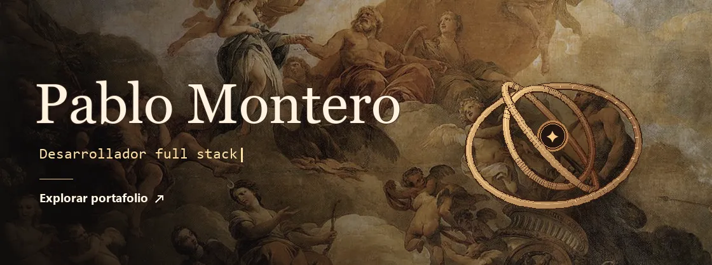
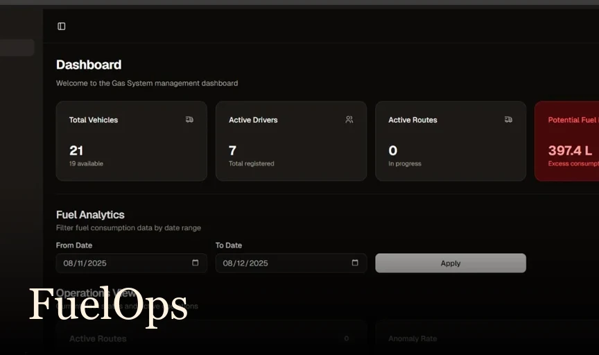
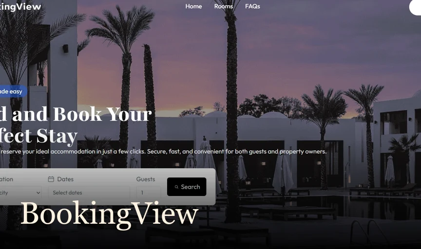

<strong>Español</strong> · <a href="README.en.md">English</a>

<a href="https://pabloaml-portfolio.vercel.app/">
  <picture>
    <source media="(prefers-reduced-motion: reduce)" srcset="assets/portada-olimpo-es.jpg">
    
  </picture>
</a>

## Sobre mí

Desarrollador full stack de Ambato, Ecuador. Construyo aplicaciones web y móviles, APIs y sistemas distribuidos. También diseño landing pages para negocios locales.

## Proyectos destacados

  
  

  
  

<a href="https://github.com/Application-Distributed-Gasoline-System/Backend">FuelOps · Backend</a> &nbsp; · &nbsp; <a href="https://github.com/Arkasys-GDP/Kaphiy">Kaphiy · Repositorio</a> 
<a href="https://github.com/DaGeus15/BookingView">BookingView · Código web</a> &nbsp; · &nbsp; <a href="https://github.com/PabloAML1/booking-native">Código móvil</a>

  
Sobre los proyectos

- **FuelOps** · Flotas, rutas y combustible · NestJS, PostgreSQL y MongoDB.
- **Kaphiy** · Pedidos por QR y panel de cocina en tiempo real · Next.js y NestJS.
- **BookingView** · Reservas de alojamiento en web y móvil · React, React Native y Node.js.
- **HambaEC** · Landing para una clínica odontológica · Astro, Tailwind CSS y GSAP.

## Tecnologías y herramientas

<a href="https://pabloaml-portfolio.vercel.app/#skills">
  <picture>
    <source media="(prefers-reduced-motion: reduce)" srcset="assets/teclado-demo-es.jpg">
    
  </picture>
</a>

<a href="https://pabloaml-portfolio.vercel.app/#skills">Abrir el teclado interactivo ↗</a>

  
Ver las 27 herramientas

- **Frontend** · Astro, React, Angular, Next.js, Tailwind CSS.
- **Backend y lenguajes** · NestJS, Laravel, Node.js, TypeScript, Java, PHP, Python.
- **DevOps y nube** · Azure, Google Cloud, Jenkins, GitHub Actions, Docker, Kubernetes, Linux.
- **Bases de datos** · SQL Server, MySQL, Oracle, MongoDB, PostgreSQL.
- **Herramientas y calidad** · SonarQube, Swagger, GitHub.

## Contribuciones en GitHub

<h2 align="center">Contacto</h2>

  
  
  

<a href="mailto:monteropablo511@gmail.com">monteropablo511@gmail.com</a>

Portada adaptada de [*La apoteosis de Hércules*, de François Lemoyne](https://commons.wikimedia.org/wiki/File:The_Apotheosis_of_Hercules.jpg). Logotipos de [Devicon](https://github.com/devicons/devicon) bajo [licencia MIT](assets/devicon-license.txt). Mapa de [GitHub Profile 3D Contrib](https://github.com/yoshi389111/github-profile-3d-contrib).
