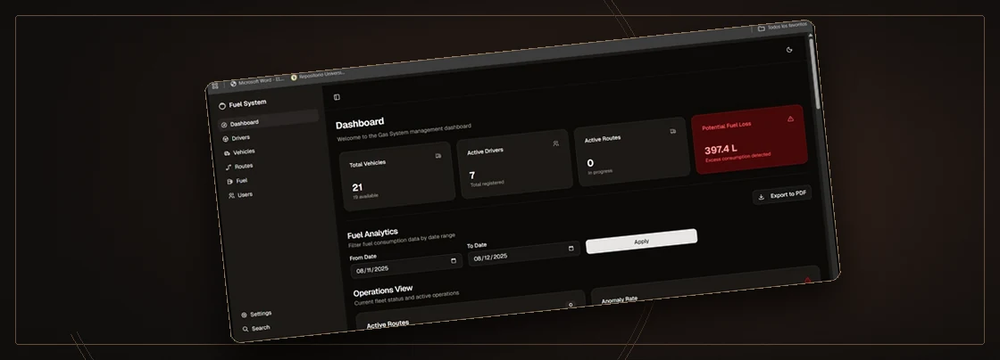
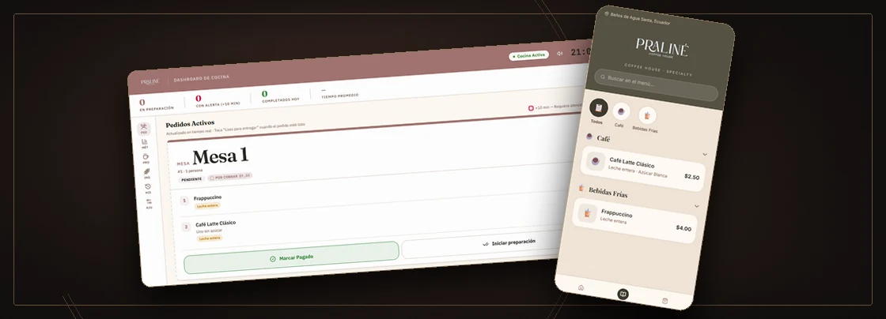
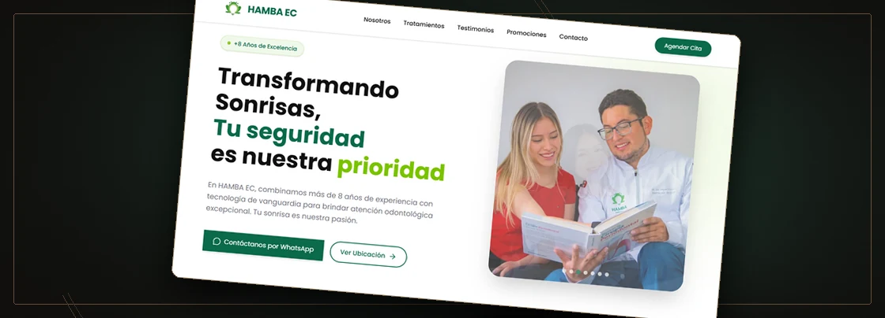
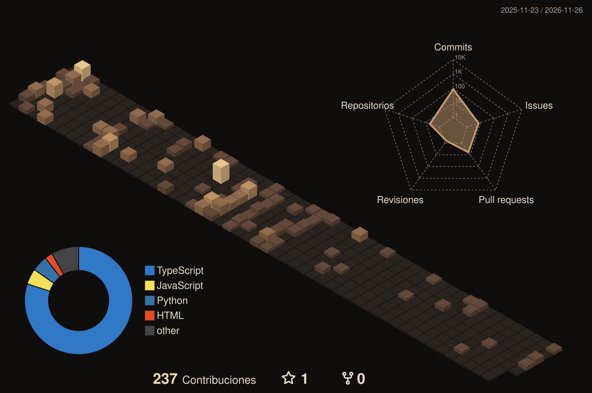

<a href="https://pabloaml-portfolio.vercel.app/">
  <picture>
    <source media="(prefers-reduced-motion: reduce)" srcset="assets/portada-cinematografica.jpg">
    
  </picture>
</a>

# Pablo Montero

Soy **desarrollador full stack** en Ambato, Ecuador. Trabajo en sistemas distribuidos, APIs e interfaces web que se adaptan al móvil.

[Portafolio](https://pabloaml-portfolio.vercel.app/) · [LinkedIn](https://www.linkedin.com/in/pablo-montero-lopez/) · [Correo](mailto:monteropablo511@gmail.com)

## Proyectos destacados

### FuelOps · Gestión de flotas y combustible

Sistema distribuido desarrollado en equipo para gestionar vehículos, conductores, rutas y consumo de combustible. Su API Gateway conecta microservicios mediante gRPC y NATS.

**NestJS · TypeScript · PostgreSQL · MongoDB · Docker Compose**

[Demo de solo lectura](https://fuelops.dayle.dev/demo) · [Repositorio del backend](https://github.com/Application-Distributed-Gasoline-System/Backend)

### Kaphiy · Pedidos para Praliné Coffee House

Los clientes escanean un código QR, consultan el menú y hacen su pedido desde el celular. El monorepo reúne la aplicación web progresiva, el panel de cocina y el backend de pedidos en tiempo real.

**Next.js · NestJS · PostgreSQL · Prisma · Socket.IO**

[Repositorio](https://github.com/Arkasys-GDP/Kaphiy)

### HambaEC · Landing page para una clínica odontológica

Una landing para una clínica odontológica, como parte de mi emprendimiento de diseño y desarrollo web para negocios de Ambato. La página presenta los tratamientos y facilita agendar una cita desde el celular.

**Astro · Tailwind CSS · GSAP**

[Ver la landing](https://hamba-ec.vercel.app/)

## Contribuciones en GitHub

Mapa generado con [GitHub Profile 3D Contrib](https://github.com/yoshi389111/github-profile-3d-contrib).
