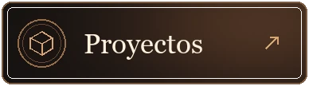
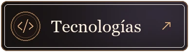
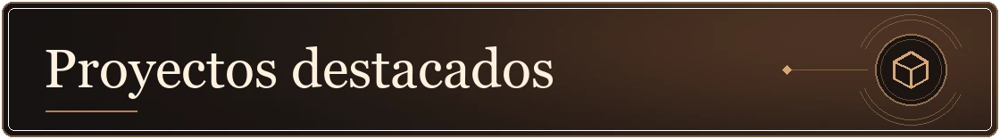
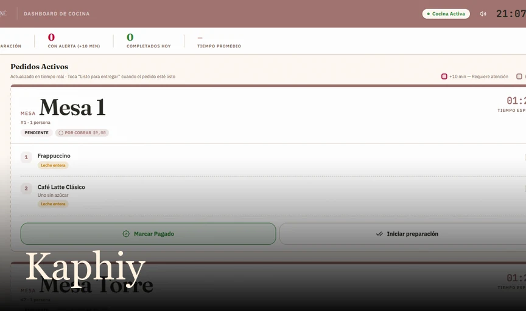
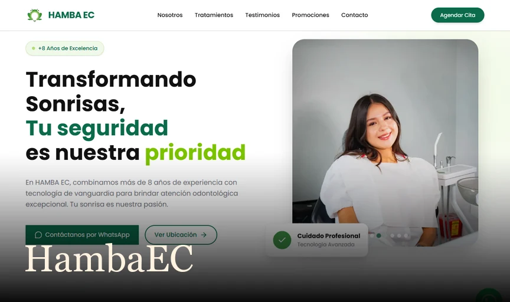
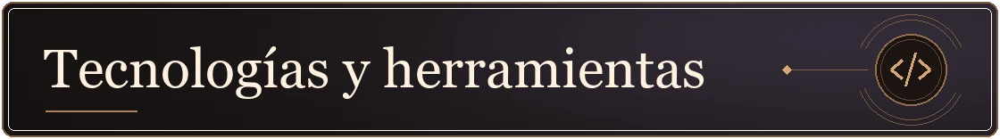
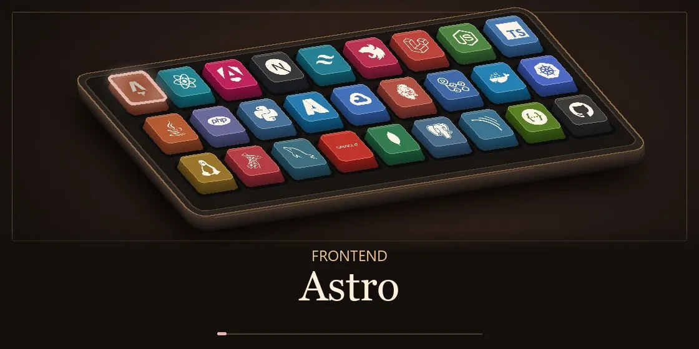

<strong>Español</strong> · <a href="README.en.md">English</a>

<a href="https://pabloaml-portfolio.vercel.app/">
  <picture>
    <source media="(prefers-reduced-motion: reduce)" srcset="assets/portada-olimpo-es.jpg">
    
  </picture>
</a>

  
  

  
  
  
  

<h2></h2>

Desarrollador full stack de Ambato, Ecuador. Construyo aplicaciones web y móviles, APIs y sistemas distribuidos. También diseño landing pages para negocios locales.

<h2></h2>

  
  

<table width="100%">
  <tr>
    <td width="50%" valign="top">
      <strong>FuelOps</strong> 
      Gestión de flotas, rutas y combustible. 
      NestJS · PostgreSQL · MongoDB 
      <a href="https://fuelops.dayle.dev/demo">Demo</a> · <a href="https://github.com/Application-Distributed-Gasoline-System/Backend">Backend</a>
    </td>
    <td width="50%" valign="top">
      <strong>Kaphiy</strong> 
      Pedidos por QR y panel de cocina. 
      Next.js · NestJS · Socket.IO 
      <a href="https://github.com/Arkasys-GDP/Kaphiy">Repositorio</a>
    </td>
  </tr>
</table>

  
  

<table width="100%">
  <tr>
    <td width="50%" valign="top">
      <strong>BookingView</strong> 
      Reservas de alojamiento en web y móvil. 
      React · React Native · Node.js 
      <a href="https://bookingview.vercel.app/">Demo</a> · <a href="https://github.com/DaGeus15/BookingView">Web</a> · <a href="https://github.com/PabloAML1/booking-native">Móvil</a>
    </td>
    <td width="50%" valign="top">
      <strong>HambaEC</strong> 
      Landing para una clínica odontológica. 
      Astro · Tailwind CSS · GSAP 
      <a href="https://hamba-ec.vercel.app/">Sitio web</a>
    </td>
  </tr>
</table>

<h2></h2>

<a href="https://pabloaml-portfolio.vercel.app/#skills">
  <picture>
    <source media="(prefers-reduced-motion: reduce)" srcset="assets/teclado-demo-es.jpg">
    
  </picture>
</a>

<a href="https://pabloaml-portfolio.vercel.app/#skills">Abrir el teclado interactivo ↗</a>

  
Ver las 27 herramientas

- **Frontend** · Astro, React, Angular, Next.js, Tailwind CSS.
- **Backend y lenguajes** · NestJS, Laravel, Node.js, TypeScript, Java, PHP, Python.
- **DevOps y nube** · Azure, Google Cloud, Jenkins, GitHub Actions, Docker, Kubernetes, Linux.
- **Bases de datos** · SQL Server, MySQL, Oracle, MongoDB, PostgreSQL.
- **Herramientas y calidad** · SonarQube, Swagger, GitHub.

<h2></h2>

<h2></h2>

  
  
  

<a href="mailto:monteropablo511@gmail.com">monteropablo511@gmail.com</a>

Portada adaptada de [*La apoteosis de Hércules*, de François Lemoyne](https://commons.wikimedia.org/wiki/File:The_Apotheosis_of_Hercules.jpg). Logotipos de [Devicon](https://github.com/devicons/devicon) bajo [licencia MIT](assets/devicon-license.txt). Mapa de [GitHub Profile 3D Contrib](https://github.com/yoshi389111/github-profile-3d-contrib).
